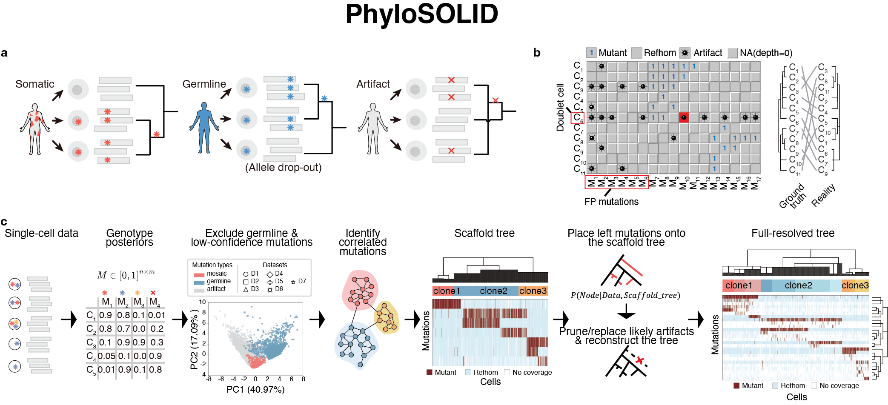

# PhyloSOLID

**Phylogeny reconstruction from single-cell mutation data.**

PhyloSOLID builds a scaffold tree, integrates additional mutations, refines their
placements and applies cell/mutation quality control. It supports scRNA-seq,
scDNA-seq, SpaceTracer and pre-called binary matrices, and exports trees,
observed/inferred genotype matrices and discordance statistics.

[Quick start](#quick-start) · [Run your data](#run-your-data) · [Outputs](#outputs) · [Documentation](#documentation) · [Citation](#citation)



## Choose a mode

| Your starting point | Mode | Input |
|---|---|---|
| Pre-called mutation genotypes | `binary-matrix` | Cell × mutation TSV with `0`, `1`, `NA` |
| Single-cell RNA sequencing | `scrna` | BAM, mutation list and cell barcodes |
| Single-cell DNA sequencing | `scdna` | One BAM per cell and a mutation list; bulk BAM optional |
| BAM-based tracing without feature extraction/classifier | `spacetracer` | BAM, mutation list and cell barcodes |

Developed and tested primarily on Linux. The software is under active development;
Current version: **v3.6.0**; see [changes and release history](docs/changelog.md).

## Quick start

### Install the tree-building environment

```bash
git clone https://github.com/douymLab/PhyloSOLID.git
cd PhyloSOLID
bash install.sh
conda activate phylosolid_env
pip install -e .
```

A conda or mamba installation is required. `install.sh` creates the tree-building
environment and installs the R dependency for Newick conversion. For BAM workflows,
configure external tools and resources before running your data; see
[installation and resources](docs/installation.md).

### Try a bundled demo

The binary-matrix demo needs no BAM, ANNOVAR or reference-resource download:

```bash
bash demo/binary-matrix/run_demo.sh
```

Two BAM-based demos are also available after mode-specific setup:

```bash
bash demo/scdna/run_demo.sh
bash demo/scrna/run_demo.sh
```

scDNA mini BAMs are included. Download the scRNA demo BAM from the
[resource collection](https://figshare.com/s/2aee3e878688722e9c6f) and place it at
`demo/scrna/input/demo_scrna.bam`. Demo scripts build trees and then draw circos
if a separate visualization environment is available.

| Demo | Step 7 pre-QC cells × mutations | Step 8 post-QC cells × mutations |
|---|---:|---:|
| scRNA | 433 × 17 | 352 × 17 |
| scDNA | 22 × 78 | 22 × 78 |
| Binary matrix | 13 × 21 | 8 × 19 |

These example results were refreshed on 2026-10-27. Full runs write to
`demo/<mode>/output/`; packaged trees, matrices, plots and summaries are in
`demo/<mode>/expected_output/`. See [demo instructions](demo/README.md) for inputs
and the scope of the refresh.

## Run your data

### Binary matrix

```bash
phylosolid binary-matrix \
  --sampleid SAMPLE_ID --inputfile matrix.tsv --outputpath results
```

Rows are cells, columns are mutations, and the first column contains cell IDs.
This mode skips classifier, germline filtering and coverage CV search.

### scRNA

```bash
phylosolid --config config/paths.yaml --workdir results scrna \
  --sample SAMPLE_ID --mutation-list mutations.txt \
  --bam sample.bam --barcode barcodes.txt \
  --read-len 120 --cellnum 3319 --threads 4
```

Set read length and cell count for your data. Cell-type annotation is optional
(`--celltype-file celltype.tsv`). BAM preprocessing requires external resources;
copy [config/paths.yaml.template](config/paths.yaml.template) to `config/paths.yaml`
and edit it for your machine.

### scDNA

```bash
phylosolid --config config/paths.yaml --workdir results scdna \
  --sample SAMPLE_ID --mutation-list mutations.txt \
  --bam-dir /path/to/sc_bams --sample-list sample_list.txt --threads 4
```

Use `{cell}.bam` files or `--bam-list bam_paths.txt`. Configure the external
unphased genotyper via `scdna.genotyper_dir` or `PHYLOSOLID_GENOTYPER_DIR`.
Bulk BAM is optional.

SpaceTracer commands, input formats, annotations and selective pipeline stages
are described in the [usage guide](docs/usage.md). Run `phylosolid MODE --help`
for pipeline arguments. CV search and resolution-backoff controls belong to the
[direct tree-building entry points](docs/tree_building.md), not the pipeline CLI.

## Outputs

Each mode writes a final-results directory containing:

```text
final-results/
├── phylo/             # Step 8 output; marked pre_fallback if restored from Step 7
├── phylo_unpruned/    # Step 7 snapshot before Step 8 QC
└── README_phylo.txt
```

**Both bundles remove all-zero inferred matrix rows/columns and collapse the
corresponding tree nodes.** `phylo_unpruned` is already refined by Step 7; it is
not raw input. Each bundle's `output_stage.json` records its stage, dimensions
and Omega. When Step 8 leaves no usable tree, `phylo/` uses the Step 7 snapshot
and is explicitly marked `pre_fallback`.

| Mode | Final-results path under the sample directory | Cell annotation |
|---|---|---|
| scRNA / scDNA | `03_tree_building/05_final_results/` | `03_tree_building/03_scaffold_builder/df_celltype.txt` |
| SpaceTracer | `03_tree_building/04_final_results/` | `03_tree_building/02_scaffold_builder/df_celltype.txt` |
| Binary matrix | `03_final_results/` | `01_scaffold_builder/df_celltype.txt` |

Start with `phylo/final_cleaned_tree_node.json` or `.txt` and
`phylo/final_cleaned_M_full_basedPivots.filtered_sites_inferred.CFMatrix`.
The aligned observed matrix is `final_cleaned_I_full_withNA3_for_circosPlot.txt`;
missing observations are encoded as `3` in this export. Flip-count tables
summarize disagreements between observations and inferred genotypes.

CV search writes `cv_search_summary.csv` and `cv_selection_report.txt` in the
tree-building directory. The pruning ratio is an operational selection guard,
not a confidence probability. See [scoring and selection](docs/tree_building.md)
and [output-stage details](docs/phylo_output_stages.md).

## Visualization

Circos uses the separate [PhyloSOLIDvis](https://github.com/TsingYang1112/PhyloSOLIDvis)
R package and environment:

```bash
bash install_vis.sh
bash scripts/visualization/run_circos.sh \
  path/to/final-results/phylo \
  path/to/final-results/circos \
  path/to/scaffold-builder/df_celltype.txt
```

Use the `phylo/` directory as input and the pipeline's exported annotation table.
Keep visualization dependencies separate from `phylosolid_env` / `pmg`.
See [visualization and interactive inspection](docs/visualization.md) for R usage,
plot options, upload files for the [inspection platform](https://phylosolid.westlake.edu.cn),
and troubleshooting.

## Documentation

| Guide | Contents |
|---|---|
| [Installation](docs/installation.md) | ANNOVAR, reference downloads, configuration and environments |
| [Usage and inputs](docs/usage.md) | All modes, file formats, annotations and selective stages |
| [Complete parameter reference](docs/parameters.md) | Every CLI/dictionary setting, defaults by mode, active conditions and key mechanisms |
| [Tree-building controls](docs/tree_building.md) | CV search, metrics, resolution controls and Step 1–9 |
| [Output stages](docs/phylo_output_stages.md) | Pre-QC/post-QC bundles, cleanup and fallback |
| [Resolution backoff](docs/resolution_backoff.md) | Conflict budget, audit files and limitations |
| [Visualization](docs/visualization.md) | Circos, R examples and interactive inspection |
| [Troubleshooting](docs/troubleshooting.md) | Setup, runtime and output issues |
| [Demos](demo/README.md) | Bundled inputs and regenerated result snapshots |
| [Version history](docs/changelog.md) | Current source updates and tagged releases |

The [workflow overview](images/1figure_plot.png) illustrates the pipeline.

## Citation

Yang, Q. et al. *PhyloSOLID: Robust phylogeny reconstruction from single-cell data
despite inherent error and sparsity.* (2026).
DOI: [10.64898/2026.02.04.703905](https://doi.org/10.64898/2026.02.04.703905).

## License

[MIT License](LICENSE). ANNOVAR and other dependencies have their own installation
and licensing requirements. Python/R dependencies are listed in
[environment.yml](environment.yml).

## Contact

Qing Yang: yangqing@westlake.edu.cn

Yanmei Dou: yanmeidou@westlake.edu.cn
